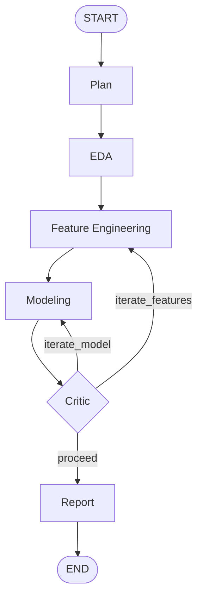

# Autonomous Data Scientist

A multi-agent pipeline, orchestrated with **LangGraph** and powered by **Claude**,
that takes a raw tabular dataset and autonomously plans an analysis, explores
the data, engineers features, trains and evaluates a model, critiques its own
results, and writes a polished report — with a reflection loop that lets it
go back and try again when the model underperforms.

```
python cli.py --dataset breast_cancer
```

produces `outputs/breast_cancer_report.html` (and a `.md` twin), containing
the executive summary, methodology, final metrics, EDA charts, and a full
trace of every decision the agent made along the way.

## Why this project

Resume-worthy AI projects need to demonstrate two things at once: **agent
orchestration** (state machines, conditional routing, structured LLM
decisions, reflection loops) and **real data science** (EDA, feature
engineering, model selection, evaluation). This project puts them in the
same pipeline, deliberately kept small enough that every node's prompt,
schema, and decision can be explained line by line.

## Architecture



| Node | Type | What it does |
|---|---|---|
| **Plan** | LLM (structured) | Reads the dataset's schema/description, produces a short analysis plan and names the primary metric to optimize. |
| **EDA** | Deterministic | Computes summary statistics and missing-value counts, renders a correlation heatmap and target-distribution chart. |
| **Feature Engineering** | LLM (structured) + deterministic | LLM decides `scale` / `log1p` / `drop` / `keep` per column; the transform is then applied with pandas/scikit-learn — the LLM never writes or executes code directly. |
| **Modeling** | LLM (structured) + deterministic | LLM picks a scikit-learn model (and hyperparameters) from a fixed allow-list; the code trains it with a held-out test split and 5-fold cross-validation. |
| **Critic** | LLM (structured) | Reviews the achieved metrics against the plan's target metric and decides: ship it (`proceed`), or loop back to `iterate_features` / `iterate_model`. A hard `max_iterations` cap (default 2) guarantees the graph terminates. |
| **Report** | LLM (free text) + deterministic | LLM writes the narrative (executive summary, methodology, results, recommendations); code assembles it with the charts and full agent trace into Markdown + a self-contained HTML file. |

### Design decisions worth explaining in an interview

- **Structured outputs over free-form code execution.** Every LLM decision
  (feature transforms, model choice, critique) is a validated Pydantic
  model (`src/agent/state.py`), not a code string the agent writes and the
  host executes. This makes the pipeline deterministic, reviewable, and
  safe to run unattended — at the cost of a fixed action space instead of
  arbitrary flexibility.
- **The reflection loop is the orchestration centerpiece.** `critic_node`
  routes back into `feature_engineering` or `modeling` via LangGraph's
  `add_conditional_edges`, carrying its feedback into the next iteration's
  prompt. This is a real cycle in the graph, bounded by `max_iterations`
  so it always terminates.
- **Tools vs. agent boundary.** `src/agent/tools.py` holds all the actual
  pandas/scikit-learn logic and has zero LangChain/Claude imports — it's
  unit-tested in isolation (see `tests/`) independent of any LLM call.
  `src/agent/nodes.py` is the thin layer that turns LLM decisions into
  calls against those tools.
- **Bundled datasets, zero setup friction.** The three sample datasets
  (`breast_cancer`, `wine` — classification; `diabetes` — regression) ship
  inside scikit-learn, so a demo run needs nothing but an Anthropic API key.

## Setup

```bash
python3 -m venv .venv && source .venv/bin/activate
pip install -r requirements.txt
cp .env.example .env   # then edit .env and add your ANTHROPIC_API_KEY
```

## Usage

```bash
python cli.py --dataset breast_cancer          # classification demo
python cli.py --dataset wine                   # classification demo
python cli.py --dataset diabetes               # regression demo
python cli.py --dataset breast_cancer --max-iterations 3
```

Reports land in `outputs/` (gitignored). Open the `.html` file in a browser
for the full formatted report with embedded charts.

## Model configuration

Defaults to `claude-opus-5` for every node. Override via `.env`:

```
CLAUDE_MODEL=claude-sonnet-5
```

Sonnet or Haiku will run faster and cheaper for repeated demo runs; Opus
gives the strongest planning/critique quality.

## Development

```bash
pip install -r requirements-dev.txt
pytest tests/ -v
```

The test suite covers dataset loading, the deterministic EDA/feature/model
tools, and that the LangGraph graph compiles with the expected node set —
none of it calls the live Claude API, so it runs without credentials.

## Project layout

```
cli.py                      # entry point
src/
  agent/
    state.py                # AgentState + structured-output pydantic schemas
    llm.py                  # Claude client construction
    tools.py                # deterministic EDA / feature-eng / modeling logic
    nodes.py                # LangGraph node functions (bridge LLM <-> tools)
    graph.py                # StateGraph wiring + conditional routing
  data/
    datasets.py             # bundled sample datasets (sklearn toy datasets)
  report/
    generator.py            # narrative + Markdown/HTML report assembly
tests/                       # deterministic unit tests, no API calls
```
