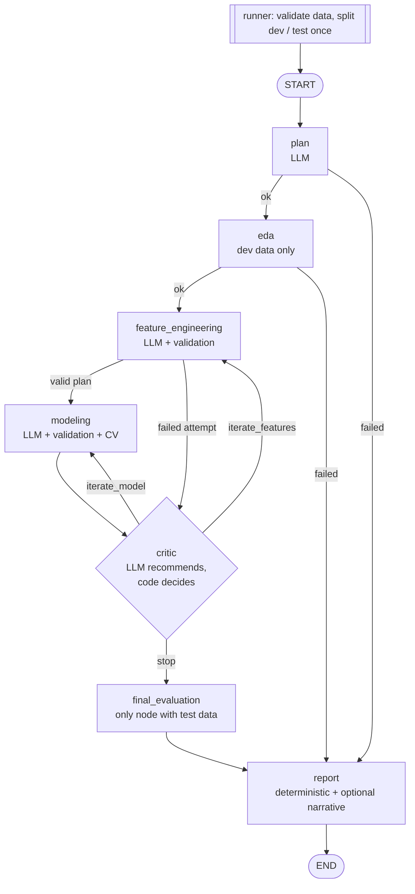

# Autonomous Data Scientist

A bounded agentic workflow for tabular modeling. LangGraph orchestrates the
steps, Claude makes a small set of constrained decisions (which metric to
recommend, how to preprocess each column, which model to try, whether to keep
iterating), and plain Python validates and executes those decisions with
predefined scikit-learn operations.

```bash
python cli.py --dataset breast_cancer --offline   # no API key needed
```

Each run writes `outputs/<run_id>/report.html`, `report.md`, `trace.json`, and
EDA charts. The report covers every candidate tried, the selected one, its
validation and final test scores, why the run stopped, and its limitations.

## The problem

A first baseline model on a new tabular dataset usually goes the same way:
look at the data, pick a metric, try some preprocessing, try a couple of
models, compare them honestly, and write up what happened. This project
automates that loop for someone (a data scientist or an engineer who has
inherited a dataset) who wants a quick, *auditable* baseline: every decision,
score, and failure is recorded, and the evaluation protocol is set up so the
final number can be trusted.

It is not an autonomous agent in the open-ended sense. The graph is fixed,
the action space is a short allow-list, the number of attempts is capped by
code, and the LLM never writes or runs code.

## Architecture



| Step | LLM decides | Code enforces |
|---|---|---|
| **runner** (`src/agent/runner.py`) | nothing | Dataset checks, one seeded and stratified dev/test split, CV feasibility, a unique run directory |
| **plan** | A short plan and a recommended metric | Metric must be on the task's allow-list. A `--metric` from the user overrides it. The LLM cannot set a threshold. |
| **eda** | nothing | Summary stats and charts on the **development** partition only |
| **feature_engineering** | One transform per column: `scale` / `log1p` / `drop` / `keep` | Exactly one step per feature, no unknown, duplicate, or conflicting columns, no target, at least one feature kept, `log1p` only on non-negative numeric columns |
| **modeling** | Model family plus `n_estimators` / `max_depth` | Family matches the task, parameters within bounds. The pipeline is cross-validated on dev data. |
| **critic** | `iterate_features` / `iterate_model` / `proceed`, plus feedback | Budget, acceptance target, and best-candidate selection (`selection.py`). Overrides are recorded. |
| **final_evaluation** | nothing | Refit the selected pipeline on all dev rows, score once on the test partition |
| **report** | Optional narrative (told not to quote numbers) | Every number is rendered from tool outputs. HTML is escaped. |

Structured output only gets a response into the right *shape*. It doesn't
make the system deterministic or safe. Live decisions still vary from run to
run, which is why every decision is checked against the actual data before
anything executes (`src/agent/validation.py`).

## Evaluation methodology

1. **One split, before anything else.** `runner.run_pipeline` splits the raw
   data into development (80%) and final test (20%) partitions, with a fixed
   seed and stratification for classification. Graph state only ever holds
   the development partition. The test partition is bound to the
   `final_evaluation` node and nothing else (`graph.build_graph`).
2. **Preprocessing lives inside the pipeline.** A feature plan becomes an
   unfitted `ColumnTransformer` inside a `Pipeline` (`tools.build_pipeline`),
   so during cross-validation each scaler is fitted on its training fold
   only. `tests/test_tools.py::test_scaler_is_fitted_on_training_folds_only`
   checks this directly.
3. **Candidates are compared on validation only.** Each candidate is scored
   with stratified (classification) or plain (regression) 5-fold CV on dev
   data. The critic sees only these validation scores.
4. **The test partition is used once.** After the loop stops, a fresh copy of
   the selected pipeline is fitted on all dev rows and scored once on the
   test partition. Nothing reads that score afterwards except the report.

Why the separation matters: the loop picks among candidates *because of*
their validation scores, so the winning validation score is optimistically
biased (you are effectively overfitting to the CV folds a little). The
untouched test partition is what gives an unbiased estimate.

### Metrics

| Metric | Task | sklearn scorer | Direction |
|---|---|---|---|
| `accuracy` | classification | `accuracy` | maximize |
| `f1_weighted` | classification | `f1_weighted` | maximize |
| `roc_auc` | binary classification only | `roc_auc` | maximize |
| `rmse` | regression | `neg_root_mean_squared_error`, sign flipped | minimize |
| `r2` | regression | `r2` | maximize |

The primary metric's scorer is passed explicitly to `cross_validate`, and the
same scorer is used on the test partition. RMSE is reported as a positive
number. For ROC AUC, sklearn treats the greater label as the positive class,
so on `breast_cancer` that is label 1 (`benign`), and the report says so.
Infeasible CV (for example a class with fewer rows than folds) raises a clear
error before the run starts, and a failing fold raises (`error_score="raise"`)
rather than turning into a NaN score.

## Validation, retries, selection, and stopping

**Failure categories** (`src/agent/errors.py`), recorded in the trace and report:

- `schema_error`: the response didn't parse into the pydantic schema
- `semantic_error`: it parsed, but it's invalid for this data or task
- `tool_error`: a scikit-learn step raised
- `api_error`: the model call itself failed

**Retries are bounded and don't stack.** For schema or semantic errors,
`llm.decide()` re-asks once with the specific validation messages
(`max_repair_attempts`, capped at 1). API errors are not retried there. The
Anthropic SDK handles transient HTTP retries, set explicitly to
`max_retries=2` with a 60s timeout. Worst case per decision: 2 asks × 3 HTTP
tries = 6 requests. A decision that still fails becomes a failed candidate,
which counts against the budget.

**Hyperparameter bounds** (`validation.HYPERPARAM_BOUNDS`):

| Model | `n_estimators` | `max_depth` |
|---|---|---|
| random forest (clf/reg) | 10–300 | 1–20 or null |
| gradient boosting (clf/reg) | 10–300 | 1–5 |
| logistic / linear regression | must be null | must be null |

The bundled datasets have at most 569 rows and 30 features, so every allowed
configuration cross-validates in a few seconds. Boosting depth is capped
lower because deep boosted trees overfit fast and get slow. Missing values
and non-numeric features are rejected up front, because the allowed
transforms include no imputer or encoder.

**Candidates and selection.** Each attempt is recorded as `C1`, `C2`, … with
its feature plan, model choice, validation metrics, CV warnings, and failure
details. `selection.select_best` picks the best valid candidate by primary
CV mean. Ties go to the lower CV standard deviation, then to the earlier
candidate. Earlier candidates are never discarded, so a worse last attempt
can't replace a better earlier one.

**Stopping is decided by code** (`selection.decide_route`), in this order:

1. The best validation score meets the user's `--threshold`: `target_met`.
2. The critic call failed: `critic_failed` (or `failed` if nothing is valid).
3. The critic says `proceed` and a valid candidate exists: `critic_proceeded`.
   With no valid candidate and budget left, code overrides it to try again.
4. `--max-candidates` attempts used (failed ones included): `budget_exhausted`
   (or `failed` if nothing is valid).
5. Otherwise, follow the critic's `iterate_*` recommendation.

Acceptance is tracked separately: `met` / `not_met` / `not_specified`, based
on validation. A threshold without an explicit `--metric` is rejected, and
with no threshold the report says no target was specified. A critic
`proceed` is presented as a judgment, never as proof that a target was met.
The final test score is compared to the threshold only as an informational
line in the report.

## Setup

```bash
python3 -m venv .venv && source .venv/bin/activate
pip install -r requirements-dev.txt
cp .env.example .env   # live runs only: set ANTHROPIC_API_KEY and CLAUDE_MODEL
```

`CLAUDE_MODEL` has no default on purpose. Set it to a model identifier your
account can call. It's read from `.env` when the client is built, not when a
module is imported. API keys are never printed or written to reports.

## Running

Offline mode, using a predefined decision script:

```bash
python cli.py --dataset breast_cancer --offline
python cli.py --dataset diabetes --offline
python cli.py --dataset breast_cancer --offline --metric roc_auc --threshold 0.999 --max-candidates 2
```

The decision script (`src/demo/offline.py`) starts with an incomplete feature
plan to show validation and repair, then does one feature refinement, one
model refinement, and a `proceed`. Offline reports are marked "offline mode".
Splitting, CV, selection, and test scoring run exactly as in live mode.

Live run with Claude:

```bash
python cli.py --dataset breast_cancer
python cli.py --dataset wine --metric f1_weighted --max-candidates 4
python cli.py --dataset diabetes --metric rmse --threshold 55
```

Options: `--metric`, `--threshold` (needs `--metric`), `--max-candidates`
(1–10, default 3), `--seed` (default 42), `--output-dir`.

**Not verified:** live mode has not been run against the Anthropic API as part
of this change. The client wiring is unit-tested without network access, but
structured-output behavior, token usage reporting, and the model identifier
all need a real live run to confirm.

## Observability

`trace.json` records the run ID, mode, model identifier, dataset, seed, full
config, split sizes, plan, every candidate, every critic decision (including
overrides), final test results, and a list of events. Each event has a node,
candidate ID, LLM attempt number, status, elapsed time, validation errors,
routing decision, and stop reason where relevant. Token usage comes from
the SDK's `usage_metadata` when it's there. Otherwise it's labeled
unavailable (or not applicable offline). A cost estimate appears only if you
set prices in `.env`, and it's labeled as an estimate. The trace holds
aggregate statistics, never raw data rows.

LLM-written reasoning and feedback are stored as generated explanations.
They aren't verified analysis and aren't a view into the model's internal
reasoning.

## Why LangGraph (and when you wouldn't need it)

The workflow has a real cycle with two re-entry points (features or model),
failure shortcuts, and a stop branch. LangGraph makes that routing explicit
and inspectable (`graph.py` is about 40 lines), its reducers let nodes
append to candidate and event history without clobbering it, and it would
make checkpointing or human-in-the-loop approval easy to add later.

That said, this graph is small and fixed. A plain Python `while` loop over
the same node functions would work fine and be slightly easier to debug. You
would want LangGraph once you need persistence and resume, parallel
branches, streaming of intermediate state, or human approval steps.

## Limitations and what production would need

- Small allow-listed action space: no imputation, categorical encoding,
  feature creation, or hyperparameter search beyond two parameters.
- One split and one CV seed. On a few hundred rows, the test score can shift
  by a few points under a different seed. Repeated or nested CV would be
  more robust.
- The candidate budget is the main guard against overfitting the validation
  scores. It reduces the problem but doesn't remove it.
- Bundled sklearn datasets only. Real data would need schema handling,
  missing-value strategies, leakage checks on features, and data size limits.
- Live mode is unverified here (see above).
- Production would also need: persisted runs and resume (a LangGraph
  checkpointer), per-run cost limits, model and data versioning, a review
  step before any model ships, and monitoring after deployment.

## Development

```bash
pytest tests/ -v
```

The tests use scripted LLM responses (`src/agent/fake_llm.py`) and need no
API key or network. They cover refinement paths, budget enforcement,
best-candidate preservation, metric direction, failure categories and repair
limits, fold-level preprocessing, test-partition isolation, scorer wiring,
report content and HTML escaping, run isolation, and `.env` model
configuration.

## Project layout

```
cli.py                      # entry point (live / --offline)
src/
  agent/
    runner.py               # preflight, dev/test split, run directory, graph execution
    graph.py                # StateGraph wiring and routing
    nodes.py                # node functions (prompts -> decide() -> tools)
    llm.py                  # Claude client, model config, bounded decide/repair loop
    fake_llm.py             # scripted LLM for tests and offline demo
    state.py                # RunConfig, decision schemas, graph state
    validation.py           # semantic checks and hyperparameter bounds
    selection.py            # best-candidate selection, stopping rules, acceptance
    metrics.py              # metric allow-list, scorers, directions
    tools.py                # split, EDA, pipeline building, CV, final evaluation
    errors.py               # failure categories
  data/datasets.py          # bundled sklearn datasets
  demo/offline.py           # decision script for offline mode
  report/generator.py       # Markdown/HTML report and trace.json
tests/                      # behavior tests, no API calls
```
